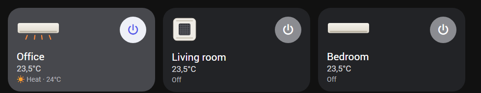
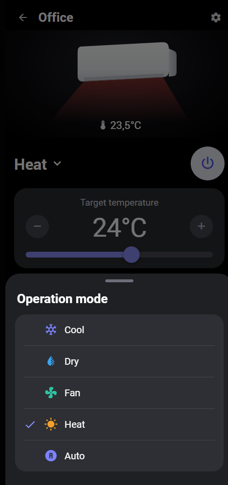

# ThinQ Airco Card

A Home Assistant dashboard card for **LG air conditioners**, styled like the **LG ThinQ app**:
a compact tile for your dashboard that opens a full control screen with the same layout as the app.

Works with the climate entities of the [smartthinq_sensors](https://github.com/ollo69/ha-smartthinq-sensors) integration.
Other climate entities work too, LG-specific extras (jet mode, sleep timer, filter) are simply hidden.

| Tile | Control screen | Operation mode | Airflow | Useful features |
|---|---|---|---|---|
|  |  |  |  |  |

## Features

- Tile like the ThinQ overview: unit picture, name, room temperature, power button; airflow lines in the colour of the mode
- Control screen like the ThinQ device page:
  - operation mode sheet (Cool, Dry, Fan, Heat, Auto)
  - target temperature with − / + and slider (sent after a short pause, so several taps become one command)
  - fan speed with ‹ ›, airflow sheet (up/down and left/right louvre positions, swing)
  - sleep timer, jet mode ("Extra snel")
  - *Useful features* tab: filter life, power, energy, display light, Wi-Fi
- Related LG entities are found automatically on the same device
- Three looks: `lg` (dark ThinQ colours), `glass` (frosted glass), `theme` (follows your Home Assistant theme)
- Dutch and English, following the language of the Home Assistant user
- Wall unit or ceiling cassette picture

## Installation

### Marketplace (HACS)

1. Open the **Marketplace** (HACS) in Home Assistant → ⋮ → **Custom repositories**.
2. Add `https://github.com/schmeitz/thinq-airco-card` with type **Dashboard**.
3. Search for **ThinQ Airco Card**, install, and reload the browser.

New versions show up as an update in Home Assistant.

### Manual

Copy `dist/thinq-airco-card.js` to `/config/www/thinq-airco-card/` and add it as a dashboard resource
(`/local/thinq-airco-card/thinq-airco-card.js`, type *JavaScript module*).

## Configuration

```yaml
type: custom:thinq-airco-card
entity: climate.living_room_ac
name: Living room
```

| Option | Default | Description |
|---|---|---|
| `entity` | – | **Required.** Climate entity of the air conditioner. |
| `name` | friendly name | Name on the tile and control screen. |
| `layout` | `tile` | `tile`: tile that opens the control screen. `full`: control screen inside the card. |
| `unit` | `wall` | Picture: `wall` (wall unit) or `cassette` (ceiling cassette). |
| `background` | `lg` | `lg`, `glass` or `theme`. |
| `language` | user language | `nl` or `en`. |
| `temperature_sensor` | – | Show the temperature of another sensor (useful when the unit's own sensor is off). |
| `jet_mode`, `display_light`, `sleep_time`, `filter`, `power`, `energy`, `ssid` | auto | Entity overrides. Found automatically on the same device; set to `false` to hide. |

Example with everything:

```yaml
type: custom:thinq-airco-card
entity: climate.living_room_ac
name: Living room
unit: cassette
background: glass
temperature_sensor: sensor.living_room_average_temperature
```

### Notes

- The sleep timer uses the `smartthinq_sensors.set_sleep_time` action. Because the LG cloud reports the
  timer back with a delay, the card remembers the chosen end time in the browser.
- Fan mode `diffuse` (LG "nature wind") is shown as **Auto**, like in the ThinQ app.
- Operation schedules from the ThinQ app are not exposed by the integration and are therefore not on the card.

## Nederlands

Een dashboardkaart voor LG-airco's in de stijl van de LG ThinQ-app: een tegel die een bedieningsscherm opent
met standen, doeltemperatuur, ventilator, luchtstroom, slaaptimer, Extra snel en nuttige functies.
Installeren via de **Marktplaats** (HACS) → ⋮ → **Aangepaste repositories** → deze URL met type **Dashboard**.
De kaart volgt de taal van de gebruiker (Nederlands of Engels); met `language: nl` zet je hem vast.

## Licence

MIT © 2026 Michiel Schmeitz. Not affiliated with or endorsed by LG Electronics. "LG" and "ThinQ" are trademarks of their respective owner.
