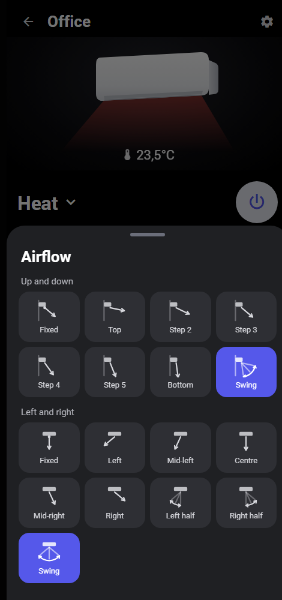
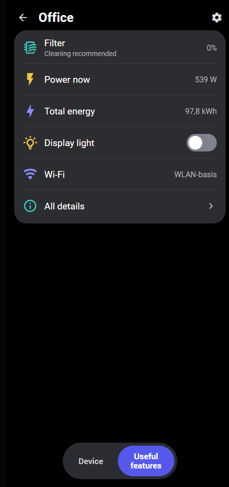

# ThinQ Airco Card

[Nederlands](#nederlands) · [English](#english)

| Tegel / Tile | Bediening / Control | Modus / Mode | Luchtstroom / Airflow | Nuttige functies / Features |
|---|---|---|---|---|
|  |  |  |  |  |

---

## Nederlands

Een dashboardkaart voor Home Assistant voor **LG-airco's**, in de stijl van de **LG ThinQ-app**:
een compacte tegel voor je dashboard die een bedieningsscherm opent met dezelfde opbouw als de app.

Werkt met de climate-entiteiten van de integratie [smartthinq_sensors](https://github.com/ollo69/ha-smartthinq-sensors).
Andere climate-entiteiten werken ook; de LG-specifieke extra's (Extra snel, slaaptimer, filter) worden dan verborgen.

### Mogelijkheden

- Tegel zoals het ThinQ-overzicht: afbeelding van de airco, naam, kamertemperatuur en aan/uit-knop; de luchtlijntjes krijgen de kleur van de stand
- Bedieningsscherm zoals de toestelpagina in de ThinQ-app:
  - blad met de bedieningsmodus (Koelen, Ontvochtigen, Ventilator, Warmte, Auto)
  - doeltemperatuur met − / + en schuifbalk (wordt na een korte pauze verstuurd, zodat een paar tikken één opdracht worden)
  - ventilatorsnelheid met ‹ ›, blad voor de luchtstroom (lamelstanden op en neer, links en rechts, zwenken)
  - slaaptimer en Extra snel (Jet mode)
  - tabblad *Nuttige functies*: filter, stroomverbruik, energie, displayverlichting, wifi
- Bijbehorende LG-entiteiten worden automatisch gevonden op hetzelfde apparaat
- Drie stijlen: `lg` (donkere ThinQ-kleuren), `glass` (matglas), `theme` (volgt je Home Assistant-thema)
- Nederlands en Engels, volgens de taal van de Home Assistant-gebruiker
- Afbeelding van een wandunit of een plafondcassette

### Installeren

**Via de Marktplaats (HACS)**

1. Open in Home Assistant de **Marktplaats** (HACS) → ⋮ → **Aangepaste repositories**.
2. Voeg `https://github.com/schmeitz/thinq-airco-card` toe met type **Dashboard**.
3. Zoek **ThinQ Airco Card**, installeer hem en ververs de browser.

Nieuwe versies verschijnen daarna vanzelf als update in Home Assistant.

**Handmatig**

Kopieer `dist/thinq-airco-card.js` naar `/config/www/thinq-airco-card/` en voeg hem toe als dashboardbron
(`/local/thinq-airco-card/thinq-airco-card.js`, type *JavaScript-module*).

### Instellen

```yaml
type: custom:thinq-airco-card
entity: climate.airco_woonkamer
name: Woonkamer
```

| Optie | Standaard | Omschrijving |
|---|---|---|
| `entity` | – | **Verplicht.** Climate-entiteit van de airco. |
| `name` | vriendelijke naam | Naam op de tegel en het bedieningsscherm. |
| `layout` | `tile` | `tile`: tegel die het bedieningsscherm opent. `full`: bedieningsscherm direct in de kaart. |
| `unit` | `wall` | Afbeelding: `wall` (wandunit) of `cassette` (plafondcassette). |
| `background` | `lg` | `lg`, `glass` of `theme`. |
| `language` | taal van de gebruiker | `nl` of `en`. |
| `temperature_sensor` | – | Toon de temperatuur van een andere sensor (handig als de sensor van de airco zelf afwijkt). |
| `jet_mode`, `display_light`, `sleep_time`, `filter`, `power`, `energy`, `ssid` | automatisch | Andere entiteit opgeven. Standaard gezocht op hetzelfde apparaat; zet op `false` om te verbergen. |

Voorbeeld met alles erop en eraan:

```yaml
type: custom:thinq-airco-card
entity: climate.airco_woonkamer
name: Woonkamer
unit: cassette
background: glass
temperature_sensor: sensor.woonkamer_gemiddelde_temperatuur
```

### Goed om te weten

- De slaaptimer gebruikt de actie `smartthinq_sensors.set_sleep_time`. De LG-cloud meldt de timer met vertraging
  terug, daarom onthoudt de kaart de gekozen eindtijd in de browser.
- Ventilatorstand `diffuse` (LG "natuurlijke wind") heet op de kaart **Auto**, net als in de ThinQ-app.
- De schema's uit de ThinQ-app geeft de integratie niet door; die staan dus niet op de kaart.

---

## English

A Home Assistant dashboard card for **LG air conditioners**, styled like the **LG ThinQ app**:
a compact tile for your dashboard that opens a full control screen with the same layout as the app.

Works with the climate entities of the [smartthinq_sensors](https://github.com/ollo69/ha-smartthinq-sensors) integration.
Other climate entities work too; LG-specific extras (jet mode, sleep timer, filter) are simply hidden.

### Features

- Tile like the ThinQ overview: unit picture, name, room temperature, power button; airflow lines in the colour of the mode
- Control screen like the ThinQ device page:
  - operation mode sheet (Cool, Dry, Fan, Heat, Auto)
  - target temperature with − / + and slider (sent after a short pause, so several taps become one command)
  - fan speed with ‹ ›, airflow sheet (up/down and left/right louvre positions, swing)
  - sleep timer and jet mode
  - *Useful features* tab: filter life, power, energy, display light, Wi-Fi
- Related LG entities are found automatically on the same device
- Three looks: `lg` (dark ThinQ colours), `glass` (frosted glass), `theme` (follows your Home Assistant theme)
- Dutch and English, following the language of the Home Assistant user
- Wall unit or ceiling cassette picture

### Installation

**Marketplace (HACS)**

1. Open the **Marketplace** (HACS) in Home Assistant → ⋮ → **Custom repositories**.
2. Add `https://github.com/schmeitz/thinq-airco-card` with type **Dashboard**.
3. Search for **ThinQ Airco Card**, install, and reload the browser.

New versions show up as an update in Home Assistant.

**Manual**

Copy `dist/thinq-airco-card.js` to `/config/www/thinq-airco-card/` and add it as a dashboard resource
(`/local/thinq-airco-card/thinq-airco-card.js`, type *JavaScript module*).

### Configuration

```yaml
type: custom:thinq-airco-card
entity: climate.living_room_ac
name: Living room
```

| Option | Default | Description |
|---|---|---|
| `entity` | – | **Required.** Climate entity of the air conditioner. |
| `name` | friendly name | Name on the tile and control screen. |
| `layout` | `tile` | `tile`: tile that opens the control screen. `full`: control screen inside the card. |
| `unit` | `wall` | Picture: `wall` (wall unit) or `cassette` (ceiling cassette). |
| `background` | `lg` | `lg`, `glass` or `theme`. |
| `language` | user language | `nl` or `en`. |
| `temperature_sensor` | – | Show the temperature of another sensor (useful when the unit's own sensor is off). |
| `jet_mode`, `display_light`, `sleep_time`, `filter`, `power`, `energy`, `ssid` | auto | Entity overrides. Found automatically on the same device; set to `false` to hide. |

Example with everything:

```yaml
type: custom:thinq-airco-card
entity: climate.living_room_ac
name: Living room
unit: cassette
background: glass
temperature_sensor: sensor.living_room_average_temperature
```

### Notes

- The sleep timer uses the `smartthinq_sensors.set_sleep_time` action. Because the LG cloud reports the
  timer back with a delay, the card remembers the chosen end time in the browser.
- Fan mode `diffuse` (LG "nature wind") is shown as **Auto**, like in the ThinQ app.
- Operation schedules from the ThinQ app are not exposed by the integration and are therefore not on the card.

---

## Licentie / Licence

MIT © 2026 Michiel Schmeitz. Niet gelieerd aan of goedgekeurd door LG Electronics. "LG" en "ThinQ" zijn handelsmerken van hun eigenaar.
Not affiliated with or endorsed by LG Electronics. "LG" and "ThinQ" are trademarks of their respective owner.
