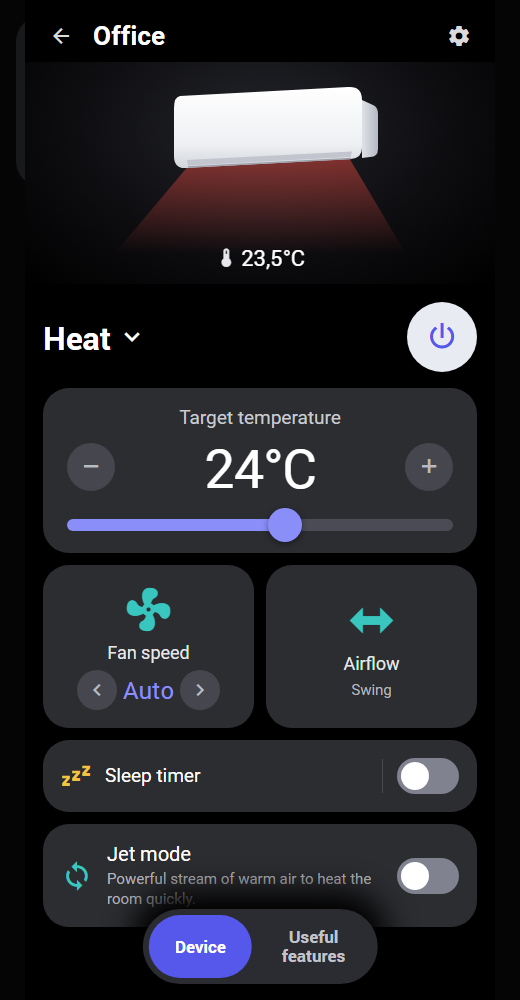
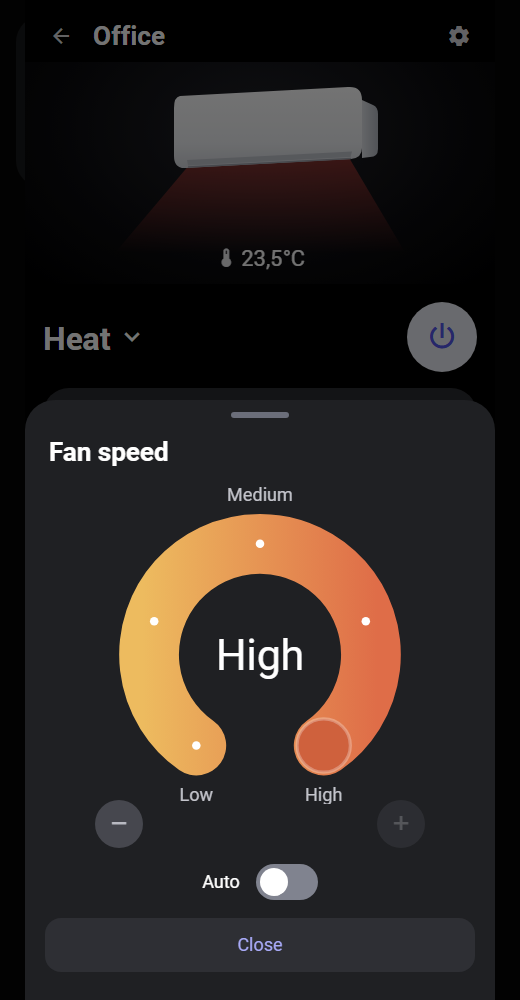
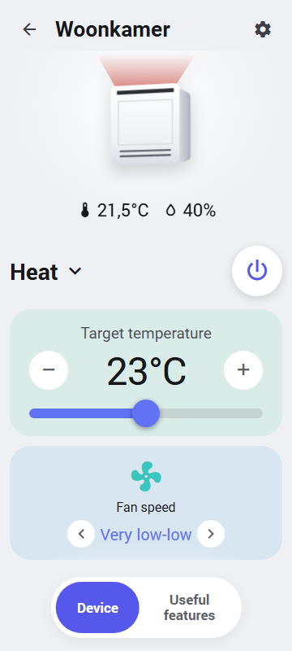
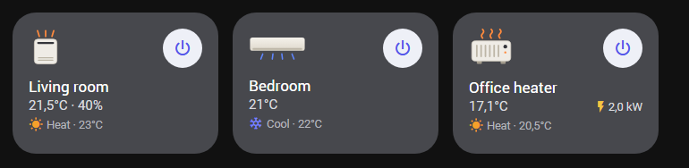
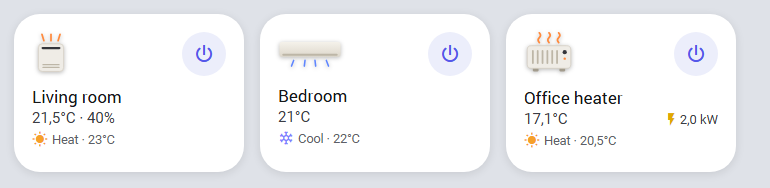

<p align="center"></p>
<h1 align="center">ThinQ Airco Card</h1>
<p align="center">
  LG air conditioners in Home Assistant, styled like the LG ThinQ app<br>
  LG-airco's in Home Assistant, in de stijl van de LG ThinQ-app
</p>
<p align="center">
  <a href="https://github.com/schmeitz/thinq-airco-card/releases/latest"></a>
  <a href="https://hacs.xyz"></a>
  <a href="https://github.com/schmeitz/thinq-airco-card/releases"></a>
  <a href="LICENSE"></a>
</p>
<p align="center">
  <a href="https://my.home-assistant.io/redirect/hacs_repository/?owner=schmeitz&repository=thinq-airco-card&category=plugin"></a>
</p>
<p align="center"><a href="#nederlands">Nederlands</a> · <a href="#english">English</a> · <a href="CHANGELOG.md">Changelog</a></p>

| Tegel / Tile | Bediening / Control | Luchtstroom / Airflow | Ventilator / Fan | Licht / Light |
|---|---|---|---|---|
|  |  |  |  |  |

**Wandunit, consolemodel, plafondcassette en elektrische kachel / Wall unit, console, ceiling cassette and electric heater**




---

## Nederlands

Een dashboardkaart voor Home Assistant voor **LG-airco's**, in de stijl van de **LG ThinQ-app**:
een compacte tegel voor je dashboard die een bedieningsscherm opent met dezelfde opbouw als de app.

Werkt met de climate-entiteiten van de integratie [smartthinq_sensors](https://github.com/ollo69/ha-smartthinq-sensors).
Andere climate-entiteiten werken ook; de LG-specifieke extra's (Extra snel, slaaptimer, filter) worden dan verborgen.

### Mogelijkheden

- Tegel zoals het ThinQ-overzicht: afbeelding van de airco, naam, kamertemperatuur en aan/uit-knop; de luchtlijntjes krijgen de kleur van de stand
- Bedieningsscherm zoals de toestelpagina in de ThinQ-app:
  - blad met de bedieningsmodus (Koelen, Ontvochtigen, Ventilator, Warmte, Auto)
  - doeltemperatuur met − / + en schuifbalk (wordt na een korte pauze verstuurd, zodat een paar tikken één opdracht worden)
  - ventilatorsnelheid met ‹ › of een blad met hoefijzer, − / + en Auto (zoals in de app)
  - luchtstroom zoals in de app: Omhoog/Omlaag en Links/Rechts met afbeelding, pijlknoppen en zwenk-schakelaar
  - slaaptimer en Extra snel (Jet mode)
  - tabblad *Nuttige functies*: filter, stroomverbruik, energie, displayverlichting, wifi
- Bijbehorende LG-entiteiten worden automatisch gevonden op hetzelfde apparaat
- Vier stijlen: `lg` (donkere ThinQ-kleuren), `light` (lichte ThinQ-kleuren), `glass` (matglas), `theme` (volgt je Home Assistant-thema)
- Nederlands, Engels, Duits, Frans en Spaans, volgens de taal van de Home Assistant-gebruiker
- Luchtvochtigheid naast de kamertemperatuur, en desgewenst het actuele stroomverbruik op de tegel
- Afbeelding van een wandunit, consolemodel (lage wandunit) of plafondcassette
- Ook voor een **gewone elektrische kachel** (bijvoorbeeld een stekker met een generieke thermostaat): kies de afbeelding
  `heater`. De kaart toont dan alleen aan/uit, temperatuur en eventuele voorkeuzes (eco, comfort), zodat al je
  klimaatkaarten één geheel vormen. Bediening die een apparaat niet heeft, verdwijnt altijd vanzelf.

### Installeren

**Via de Marktplaats (HACS)**

1. Open in Home Assistant de **Marktplaats** (HACS).
2. Zoek **ThinQ Airco Card**, installeer hem en ververs de browser.

Nieuwe versies verschijnen daarna vanzelf als update in Home Assistant.

**Handmatig**

Kopieer `dist/thinq-airco-card.js` naar `/config/www/thinq-airco-card/` en voeg hem toe als dashboardbron
(`/local/thinq-airco-card/thinq-airco-card.js`, type *JavaScript-module*).

### Instellen

Alles is in te stellen met de **visuele editor** van Home Assistant. In YAML ziet het er zo uit:

```yaml
type: custom:thinq-airco-card
entity: climate.airco_woonkamer
name: Woonkamer
```

| Optie | Standaard | Omschrijving |
|---|---|---|
| `entity` | – | **Verplicht.** Climate-entiteit van de airco of kachel. |
| `name` | vriendelijke naam | Naam op de tegel en het bedieningsscherm. |
| `layout` | `tile` | `tile`: tegel die het bedieningsscherm opent. `full`: bedieningsscherm direct in de kaart. |
| `unit` | `wall` | Afbeelding: `wall` (wandunit), `console` (consolemodel / lage wandunit), `cassette` (plafondcassette) of `heater` (elektrische kachel). |
| `background` | `lg` | `lg`, `light`, `glass` of `theme`. |
| `language` | taal van de gebruiker | `nl`, `en`, `de`, `fr` of `es`. |
| `show_power` | `false` | `true`: toon het actuele stroomverbruik op de tegel (alleen zichtbaar als het apparaat stroom verbruikt). |
| `temperature_sensor` | – | Toon de temperatuur van een andere sensor (handig als de sensor van de airco zelf afwijkt). |
| `humidity_sensor` | – | Toon de luchtvochtigheid van een andere sensor. Standaard die van de airco zelf, als die er is. |
| `jet_mode`, `display_light`, `sleep_time`, `filter`, `power`, `energy`, `ssid` | automatisch | Andere entiteit opgeven. Standaard gezocht op hetzelfde apparaat; zet op `false` om te verbergen. |

Voorbeeld met alles erop en eraan:

```yaml
type: custom:thinq-airco-card
entity: climate.airco_woonkamer
name: Woonkamer
unit: cassette
background: glass
temperature_sensor: sensor.woonkamer_gemiddelde_temperatuur
```

Een elektrische kachel:

```yaml
type: custom:thinq-airco-card
entity: climate.kantoor_kachel
name: Kachel kantoor
unit: heater
```

### Goed om te weten

- De slaaptimer gebruikt de actie `smartthinq_sensors.set_sleep_time`. De LG-cloud meldt de timer met vertraging
  terug, daarom onthoudt de kaart de gekozen eindtijd in de browser.
- Ventilatorstand `diffuse` (LG "natuurlijke wind") heet op de kaart **Auto**, net als in de ThinQ-app.
- De schema's uit de ThinQ-app geeft de integratie niet door; die staan dus niet op de kaart.
- **In ontwikkeling: luchtstroom bij consolemodellen.** Bij LG-consolemodellen (lage wandunits) geeft de integratie
  de klepstand en het zwenken nog niet door aan Home Assistant. De kaart toont het luchtstroommenu daarom nog niet
  voor deze units. Dit is gemeld bij de makers van de integratie; zodra zij het ondersteunen, verschijnt het menu vanzelf.
- Vragen, wensen of een fout gevonden? Maak een [issue](https://github.com/schmeitz/thinq-airco-card/issues) aan.

---

## English

A Home Assistant dashboard card for **LG air conditioners**, styled like the **LG ThinQ app**:
a compact tile for your dashboard that opens a full control screen with the same layout as the app.

Works with the climate entities of the [smartthinq_sensors](https://github.com/ollo69/ha-smartthinq-sensors) integration.
Other climate entities work too; LG-specific extras (jet mode, sleep timer, filter) are simply hidden.

### Features

- Tile like the ThinQ overview: unit picture, name, room temperature, power button; airflow lines in the colour of the mode
- Control screen like the ThinQ device page:
  - operation mode sheet (Cool, Dry, Fan, Heat, Auto)
  - target temperature with − / + and slider (sent after a short pause, so several taps become one command)
  - fan speed with ‹ › or a sheet with horseshoe dial, − / + and Auto (like the app)
  - airflow like the app: Up/Down and Left/Right with picture, arrow buttons and swing switch
  - sleep timer and jet mode
  - *Useful features* tab: filter life, power, energy, display light, Wi-Fi
- Related LG entities are found automatically on the same device
- Four looks: `lg` (dark ThinQ colours), `light` (light ThinQ colours), `glass` (frosted glass), `theme` (follows your Home Assistant theme)
- Dutch, English, German, French and Spanish, following the language of the Home Assistant user
- Humidity next to the room temperature, and optionally the current power use on the tile
- Wall unit, console (low wall unit) or ceiling cassette picture
- Also for a **plain electric heater** (for example a smart plug with a generic thermostat): choose the `heater`
  picture. The card then shows only power, temperature and presets (eco, comfort), so all your climate cards look
  alike. Controls a device does not have are always hidden automatically.

### Installation

**Marketplace (HACS)**

1. Open the **Marketplace** (HACS) in Home Assistant.
2. Search for **ThinQ Airco Card**, install, and reload the browser.

New versions show up as an update in Home Assistant.

**Manual**

Copy `dist/thinq-airco-card.js` to `/config/www/thinq-airco-card/` and add it as a dashboard resource
(`/local/thinq-airco-card/thinq-airco-card.js`, type *JavaScript module*).

### Configuration

Everything can be set in the Home Assistant **visual editor**. In YAML it looks like this:

```yaml
type: custom:thinq-airco-card
entity: climate.living_room_ac
name: Living room
```

| Option | Default | Description |
|---|---|---|
| `entity` | – | **Required.** Climate entity of the air conditioner or heater. |
| `name` | friendly name | Name on the tile and control screen. |
| `layout` | `tile` | `tile`: tile that opens the control screen. `full`: control screen inside the card. |
| `unit` | `wall` | Picture: `wall` (wall unit), `console` (console / low wall unit), `cassette` (ceiling cassette) or `heater` (electric heater). |
| `background` | `lg` | `lg`, `light`, `glass` or `theme`. |
| `language` | user language | `nl`, `en`, `de`, `fr` or `es`. |
| `show_power` | `false` | `true`: show the current power use on the tile (only visible while the device uses power). |
| `temperature_sensor` | – | Show the temperature of another sensor (useful when the unit's own sensor is off). |
| `humidity_sensor` | – | Show the humidity of another sensor. Defaults to the unit's own humidity, if it has one. |
| `jet_mode`, `display_light`, `sleep_time`, `filter`, `power`, `energy`, `ssid` | auto | Entity overrides. Found automatically on the same device; set to `false` to hide. |

Example with everything:

```yaml
type: custom:thinq-airco-card
entity: climate.living_room_ac
name: Living room
unit: cassette
background: glass
temperature_sensor: sensor.living_room_average_temperature
```

An electric heater:

```yaml
type: custom:thinq-airco-card
entity: climate.office_heater
name: Office heater
unit: heater
```

### Notes

- The sleep timer uses the `smartthinq_sensors.set_sleep_time` action. Because the LG cloud reports the
  timer back with a delay, the card remembers the chosen end time in the browser.
- Fan mode `diffuse` (LG "nature wind") is shown as **Auto**, like in the ThinQ app.
- Operation schedules from the ThinQ app are not exposed by the integration and are therefore not on the card.
- **In development: airflow on console units.** For LG console (low wall) units the integration does not yet pass
  the vane position and swing on to Home Assistant, so the card cannot show the airflow sheet for these units yet.
  This has been reported to the maintainers of the integration; once they support it, the sheet appears automatically.
- Questions, wishes or found a bug? Open an [issue](https://github.com/schmeitz/thinq-airco-card/issues).

---

## Licentie / Licence

MIT © 2026 Michiel Schmeitz. Niet gelieerd aan of goedgekeurd door LG Electronics. "LG" en "ThinQ" zijn handelsmerken van hun eigenaar.
Not affiliated with or endorsed by LG Electronics. "LG" and "ThinQ" are trademarks of their respective owner.
